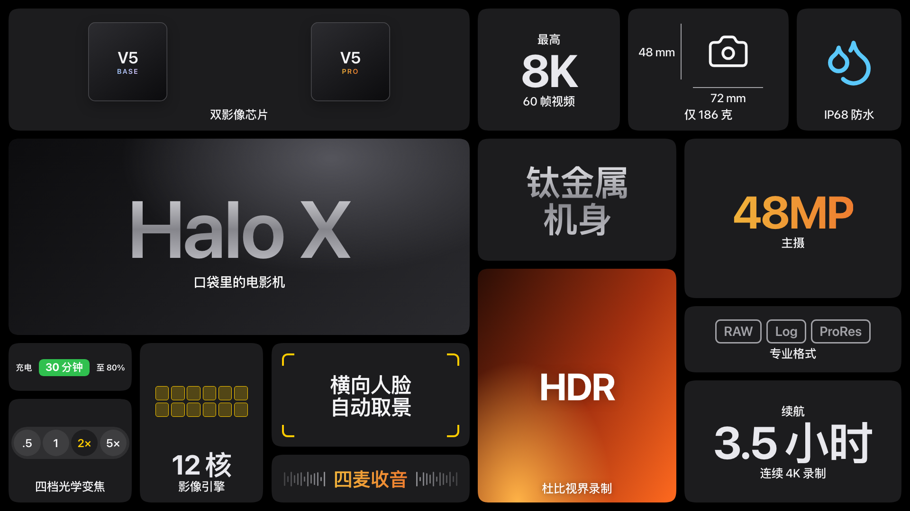
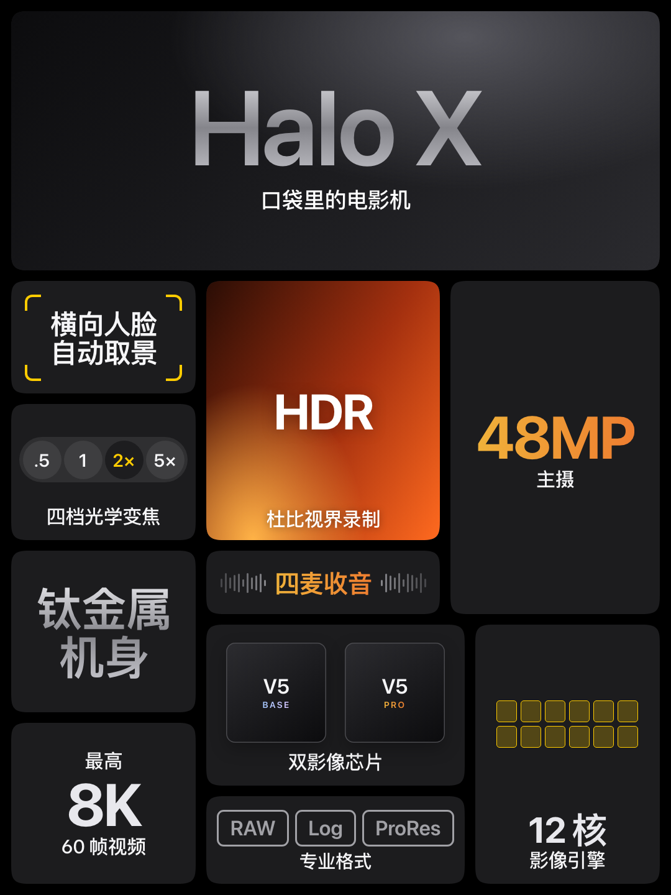
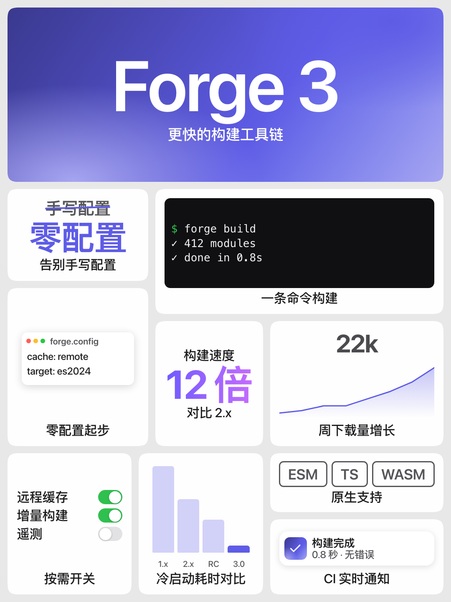
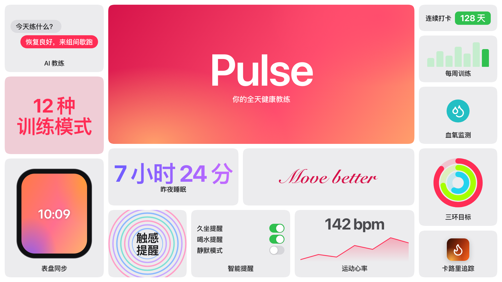
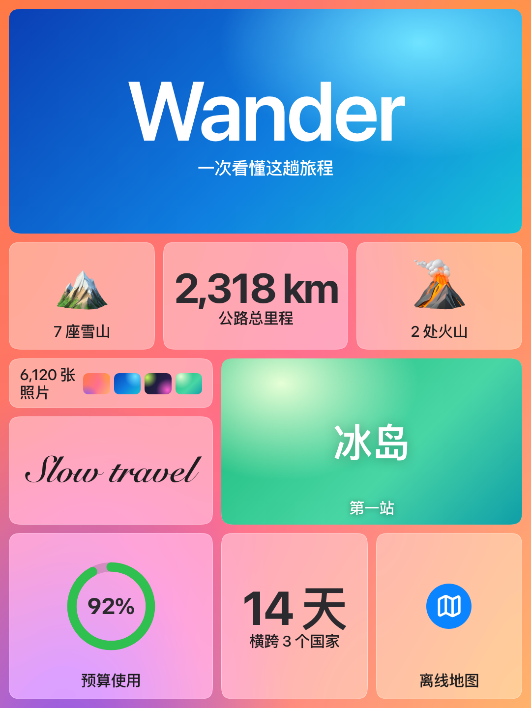
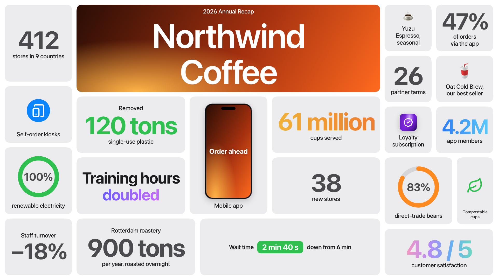
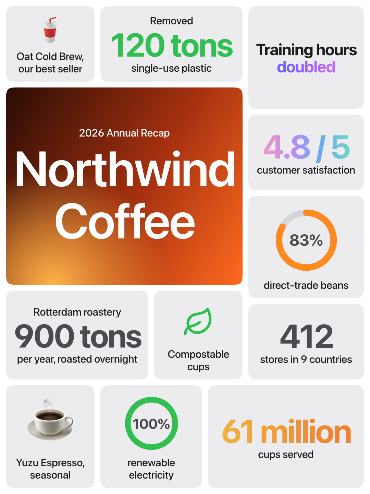

# aess

**Apple Event Summary Slides** —— 把任何内容变成一张苹果发布会风格的总结图。

一个 Agent Skill：发一段文字，得到一张便当盒（bento）版式的 PNG。不用选模板，也不用说明版式和配色。

<p>
  
  
</p>

[English](#english)

## 特点

- **小卡片跟着主题变。** 相机用变焦胶囊和对焦框，开发工具用终端和开关，健身用活动圆环和趋势图，配色也从主题里取。
- **30 种卡片。** 从苹果 2019–2026 年的总结幻灯片里提炼：数字卡、芯片方块、核心阵列、声波、聊天气泡、通知横幅、尺寸标注、删除线换词、手写环保标语等。
- **四套主题。** 白底灰卡、灰底白卡、黑底深灰卡、彩色背景上的磨砂玻璃。
- **横竖屏都能出。** 横屏 16:9 为 3840×2160，竖屏 3:4 为 2160×2880，竖屏的字号专门为手机放大。
- **真实品牌用官方素材。** 必须拿到官方 logo，配色从官方素材中提取，优先用官方产品图；都拿不到时会向你要 logo，不用替代品凑数。图标也会逐张查最贴切的，内容不够时补资料并列出来源。
- **不编数据。** 数字只来自你的内容或查到的来源，提炼时不四舍五入，也不凭空画图表。
- **零依赖渲染。** 只需要 Node 18+ 和本机的 Chrome 或 Chromium。

## 安装

适用于 Claude Code 等支持 Agent Skills 的工具：

```bash
git clone https://github.com/pengchujin/aess.git
```

```bash
ln -s "$PWD/aess/skills/aess" ~/.claude/skills/aess
```

## 使用

直接把内容发给它：

```text
/aess 我们今年开了 38 家新店，门店总数 412 家，遍布 9 个国家……
```

要手机版就说一声：

```text
/aess 做成竖屏 3:4 的手机版：……
```

有产品照片的话一起发过来，效果会好很多。

也可以不经过 Agent，直接渲染一份 spec：

```bash
node skills/aess/scripts/render.mjs skills/aess/examples/camera.json --format both -o camera.png
```

## 示例

示例内容都是虚构的，spec 在 [`skills/aess/examples`](skills/aess/examples)。

| 主题 | 横屏 | 竖屏 |
|---|---|---|
| 相机 |  |  |
| 开发工具 |  |  |
| 健身 |  |  |
| 旅行 |  |  |
| 品牌年报 |  |  |

## 工作原理

1. Agent 把内容提炼成一条条短事实，按 [样式指南](skills/aess/references/style-guide.md) 为主题选卡片、主题和配色，写成 JSON spec。
2. [`render.mjs`](skills/aess/scripts/render.mjs) 搜索不规则的便当盒布局，把字号调到正好放下，再用无头 Chrome 截图。
3. Agent 查看成图，有问题就调整后重新生成。

## 局限

- 字体依赖 macOS 的 SF 和苹方，其他系统会回退到本地无衬线字体，字形会不同。
- 没有实拍图时只能用绘制的设备、渐变和 emoji 代替，和原作差距最大的就是这里。
- 手写字体只有英文效果好。

## 致谢与声明

- 样式研究基于 Ricky Zhang 在 Figma Community 整理的 [All Apple Event Summary Slides 2019-2026](https://www.figma.com/community/file/1150817983915754582/all-apple-event-summary-slides-2019-2026)。
- 图标来自 [Lucide](https://lucide.dev)（[ISC](skills/aess/assets/icons.LICENSE)）。
- 本项目与 Apple Inc. 没有任何关联，也未获其认可或赞助。Apple 及相关名称是 Apple Inc. 的商标，这里仅用于说明所参考的设计风格。仓库不包含 Apple 的幻灯片、产品图或 logo。请自行确保生成内容和使用的素材不侵犯他人权利。

代码以 [MIT](LICENSE) 许可证开源。

---

## English

**aess (Apple Event Summary Slides)** is an Agent Skill that turns any content into one bento-style summary image, in the manner of Apple keynote recap slides. Send text, get a PNG. There are no templates to choose.

- **Small cards adapt to the subject:** lens selectors for cameras, consoles for dev tools, activity rings for fitness, with colors drawn from the topic.
- **30 card kinds** distilled from the 2019–2026 slides, in **4 themes** (white, grey, dark, frosted glass).
- **Landscape 16:9** (3840×2160) and **portrait 3:4** (2160×2880), with larger type for phones.
- **Official assets for real brands:** requires the official logo, takes colors from official artwork, and prefers official product photos. If they can't be found, it asks you rather than substituting. It also finds the closest icon for each card and fills content gaps, listing sources for you to check.
- **No invented data:** numbers come only from your content or sources it found.
- **Zero npm dependencies:** needs Node 18+ and a local Chrome or Chromium.

```bash
git clone https://github.com/pengchujin/aess.git
```

```bash
ln -s "$PWD/aess/skills/aess" ~/.claude/skills/aess
```

Then send `/aess <your content>`, or render a spec directly:

```bash
node skills/aess/scripts/render.mjs skills/aess/examples/camera.json --format both -o camera.png
```

Type relies on macOS system fonts (SF, PingFang) and falls back elsewhere. Without your own photos, the skill draws devices, gradients and emoji instead, which is the biggest gap from the originals.

Style research is based on Ricky Zhang's [Figma collection](https://www.figma.com/community/file/1150817983915754582/all-apple-event-summary-slides-2019-2026). Icons are from [Lucide](https://lucide.dev) (ISC). This project is not affiliated with, endorsed by, or sponsored by Apple Inc.; Apple names are trademarks of Apple Inc. and are used only to describe the design style referenced. The repository contains no Apple slides, product images or logos. Code is [MIT](LICENSE) licensed.
